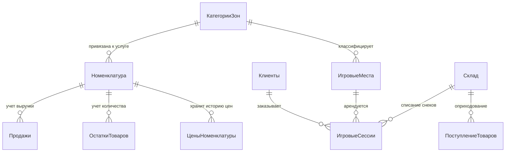

# Кейс-проект: Информационная система управления компьютерным клубом «Астра»

> **Специализация:** Разработка на платформе 1С:Предприятие 8.3 (Управляемые формы, BSL, СКД, клиент-серверная оптимизация)  
> **Целевая позиция:** Стажер / Младший разработчик 1С (Junior 1C Developer) / 1С-Программист  
> **Автор:** Роман (KBAPTETus)  
> **Технологический стек:** 1С:Предприятие 8.3.27, интерфейс «Такси», управляемые формы, язык запросов 1С, СКД, Git  

---

## 1. Готовое сопроводительное письмо (для откликов на HH.ru и Хабр Карьере)

*Текст ниже готов к копированию и отправке тимлидам и HR франчайзи («Первый Бит», «1С-Рарус», «ГЭНДАЛЬФ», «WiseAdvice» и др.):*

```text
Здравствуйте!

Меня зовут Роман, я развиваюсь в направлении разработки на платформе 1С:Предприятие 8.3. 

Хочу представить мой практический проект — конфигурацию «Компьютерный клуб Астра», автоматизирующую учет услуг аренды игровых ПК и розничной продажи сопутствующих товаров бара/снеков.

Ключевые инженерные решения, реализованные в проекте:
1. Проведение документов по современной методике 1С: запись движений в транзакции с последующим контролем отрицательных остатков через виртуальную таблицу «ОстаткиТоваров.Остатки» (позволяет сократить время блокировок СУБД в многопользовательской среде).
2. Клиент-серверная оптимизация: получение цен номенклатуры реализовано через директиву &НаСервереБезКонтекста без передачи лишних данных формы, пересчет сумм и длительности сессий происходит динамически на клиенте.
3. Учет статусов оборудования: реализован механизм блокировки ПК от повторной посадки (Свободно / Занято / Недоступно) и автоматическое освобождение при отмене проведения.
4. Управленческая аналитика на СКД: разработаны отчеты по ведомости остатков бара и динамике выручки клуба в разрезе категорий зон (Standard / VIP) и направлений бизнеса (Услуги vs Бар).

Исходный код выгружен в стандартном модульном XML/BSL формате под Git, протестирован на платформе 8.3.27.1508 и снабжен готовым файлом конфигурации (.cf) и демонстрационной базой (.dt).

Ссылка на репозиторий GitHub: https://github.com/KBAPTETus/Astra-Club-1C

Буду рад обсудить проект и возможность присоединиться к вашей команде разработки!
```

---

## 2. Паспорт проекта

| Параметр | Значение |
| :--- | :--- |
| **Наименование** | Конфигурация «КомпьютерныйКлубАстра» |
| **Платформа** | 1С:Предприятие 8.3 (протестировано на 8.3.27.1508) |
| **Режим совместимости** | Не использовать (функциональность 8.3.27) |
| **Интерфейс** | Управляемое приложение, интерфейс «Такси» |
| **СУБД** | Файловая база 1С (1CD), совместимость с PostgreSQL / MS SQL Server |
| **Режим блокировок** | Управляемый (DataLockControlMode: Managed) |
| **Контроль модальности** | Не использовать (соответствие современным стандартам 1С) |

---

## 3. Бизнес-проблематика и ценность для заказчика

Компьютерный клуб — это гибридная бизнес-модель, объединяющая **почасовую аренду оборудования** и **быструю розничную торговлю (бар, снеки, энергетики)**.

### Проблемы до автоматизации:
* **Овербукинг и конфликты:** администраторы вручную фиксировали занятость компьютеров в тетрадях/Excel, что приводило к повторной посадке гостей на одно и то же место.
* **Пересортица и недостачи в баре:** напитки и снеки продавались без оперативного складского контроля; отсутствие жестких блокировок приводило к списаниям «в минус».
* **Сложность расчета стоимости:** разные тарифные планы (почасовой, пакеты «Утро», «Вечер», «VIP») требовали ручного пересчета времени и итоговой суммы чека, создавая очереди на стойке ресепшн.
* **Отсутствие прозрачной управленческой отчетности:** владелец клуба не видел реальную загрузку залов и не мог оценить, какую долю маржи приносит бар по сравнению со стоимостью игрового времени.

### Результат внедрения:
1. Автоматический расчет времени освобождения ПК и контроль уникальности посадки.
2. Невозможность проведения чека при отсутствии товара на складе с информативным выводом количества нехватки.
3. Сокращение времени оформления сессии администратором до 20–30 секунд благодаря автоподстановке тарифов и автопересчету сумм.
4. Мгновенное формирование отчетов для руководства по выручке, маржинальности и остаткам на складе.

---

## 4. Архитектурный обзор конфигурации

### 4.1. Подсистемы
* **`Обслуживание`** — рабочее место администратора: создание игровых сессий, мониторинг занятости компьютеров, обслуживание гостей.
* **`СкладИЗакупки`** — оформление поступлений товаров бара, учет номенклатуры и поставщиков, мониторинг остатков.
* **`АналитикаИОтчеты`** — сводные финансовые отчеты и аналитика загрузки клуба для владельца и управляющего.
* **`Настройки`** — справочники оборудования, категорий зон (Standard, VIP, Bootcamp), установка цен.

### 4.2. Метаданные и модель данных



1. **Справочники:**
   * `ИгровыеМеста` (Реквизиты: `КатегорияЗоны`, `КонфигурацияПК`, `Статус` [Свободно, Занято, Недоступно]).
   * `КатегорииЗон` (Стандарт, VIP, Bootcamp, Консоли).
   * `Клиенты` (ФИО, Телефон, НомерКарты, Комментарии).
   * `Номенклатура` (Реквизиты: `ВидНоменклатуры` [Товар / Услуга], `КатегорияЗон`).
   * `Склад` (Основной бар, Склад хранения).
2. **Перечисления:**
   * `ВидыНоменклатуры` (`Товар`, `Услуга`).
   * `СпособыОплаты` (`Наличные`, `БанковскаяКарта`, `СБП`).
   * `СтатусПКМеста` (`Свободно`, `Занято`, `Недоступно`).
3. **Регистры сведений:**
   * `ЦеныНоменклатуры` (Периодический: В пределах дня, Непериодический срез). Хранит прайс-лист на тарифы ПК и снеки бара.
4. **Регистры накопления:**
   * `ОстаткиТоваров` (Вид: *Остатки*). Измерения: `Склад`, `Номенклатура`. Ресурс: `Количество`.
   * `Продажи` (Вид: *Обороты*). Измерение: `Номенклатура`. Ресурсы: `Количество`, `Выручка`.
5. **Документы:**
   * `ПоступлениеТоваров` — оформление прихода товаров бара на склад.
   * `ИгроваяСессия` (`Документ.ИгровыеСессии`) — основной операционный документ клуба.

---

## 5. Технический фокус реализации (Deep Dive)

### 5.1. Новая методика контроля отрицательных остатков
В процедуре `ОбработкаПроведения` документа `ИгровыеСессии` реализована **современная (новая) методика 1С**.

**Преимущества новой методики перед устаревшей классической:**
* В классической методике остатки читались *до* записи движений. Чтобы предотвратить состояние гонки (Race Condition), требовалось накладывать исключительные блокировки данных на время чтения и последующей записи.
* В современной методике движения сразу записываются в регистр (`Движения.ОстаткиТоваров.Записать()`), а затем одним компактным запросом проверяется наличие отрицательных остатков на текущий `МоментВремени()`. Если обнаружен отрицательный остаток — выставляется `Отказ = Истина`, платформа автоматически откатывает транзакцию, а пользователю выдается четкое сообщение с указанием дефицита.
* Время удержания транзакционных блокировок минимально, что гарантирует высокую производительность при одновременной работе нескольких администраторов.

```bsl
// Фрагмент кода: МодульОбъекта документа ИгроваяСессия
// 1. Формирование движений расхода
Для Каждого СтрБара Из ТоварыБара Цикл
    ДвОстатки = Движения.ОстаткиТоваров.ДобавитьРасход();
    ДвОстатки.Период       = Дата;
    ДвОстатки.Номенклатура = СтрБара.Номенклатура;
    ДвОстатки.Склад        = Склад;
    ДвОстатки.Количество   = СтрБара.Количество;
КонецЦикла;

// 2. Явная запись набора движений в транзакции
Движения.ОстаткиТоваров.Записать();

// 3. Контроль отрицательных остатков через виртуальную таблицу
Если ТоварыБара.Количество() > 0 Тогда
    Запрос = Новый Запрос;
    Запрос.Текст = 
        "ВЫБРАТЬ
        |   ОстаткиТоваровОстатки.Номенклатура КАК Номенклатура,
        |   ОстаткиТоваровОстатки.КоличествоОстаток КАК КоличествоОстаток
        |ИЗ
        |   РегистрНакопления.ОстаткиТоваров.Остатки(
        |           &МоментВремени,
        |           Склад = &Склад
        |               И Номенклатура В
        |                   (ВЫБРАТЬ РАЗЛИЧНЫЕ
        |                       Док.Номенклатура
        |                   ИЗ
        |                       Документ.ИгровыеСессии.ТоварыБара КАК Док
        |                   ГДЕ
        |                       Док.Ссылка = &Ссылка)) КАК ОстаткиТоваровОстатки
        |ГДЕ
        |   ОстаткиТоваровОстатки.КоличествоОстаток < 0";

    Запрос.УстановитьПараметр("МоментВремени", МоментВремени());
    Запрос.УстановитьПараметр("Склад",        Склад);
    Запрос.УстановитьПараметр("Ссылка",       Ссылка);

    Выборка = Запрос.Выполнить().Выбрать();
    Пока Выборка.Следующий() Цикл
        Отказ = Истина;
        Сообщение = Новый СообщениеПользователю;
        Сообщение.Текст = СтрШаблон(
            "Недостаточно товара ""%1"" на складе! Не хватает: %2 шт.",
            Выборка.Номенклатура,
            -Выборка.КоличествоОстаток
        );
        Сообщение.Сообщить();
    КонецЦикла;
КонецЕсли;
```

### 5.2. Оптимизация клиент-серверного взаимодействия в управляемой форме
* Для подтягивания актуальной цены из регистра сведений `ЦеныНоменклатуры` используется серверная функция с директивой `&НаСервереБезКонтекста`. Это исключает передачу всего XML-дерева контекста формы (`ДанныеФормыСтруктураСКоллекцией`) через сеть, снижает нагрузку на канал и ускоряет отклик интерфейса.
* Расчет времени окончания сессии (`ВремяОкончания = ВремяНачала + Длительность * 3600`) и сумм строк бара (`Количество * Цена`) выполняется на клиенте без лишних обращений к серверу.

```bsl
// Фрагмент кода: МодульФормы документа ИгроваяСессия
&НаСервереБезКонтекста
Функция ПолучитьАктуальнуюЦенуНаСервере(Номенклатура, ДатаСреза)
    Если Не ЗначениеЗаполнено(Номенклатура) Тогда
        Возврат 0;
    КонецЕсли;
    
    Отбор = Новый Структура("Номенклатура", Номенклатура);
    ЗначенияЦен = РегистрыСведений.ЦеныНоменклатуры.СрезПоследних(ДатаСреза, Отбор);
    
    Если ЗначенияЦен.Количество() > 0 Тогда
        Возврат ЗначенияЦен[0].Цена;
    Иначе
        Возврат 0;
    КонецЕсли;
КонецФункции
```

### 5.3. Аналитика на Системе компоновки данных (СКД)
1. **Отчет `ОтчетПоОстаткамБара`:**
   * Обращается к виртуальной таблице `РегистрНакопления.ОстаткиТоваров.Остатки`.
   * Иерархическая группировка: `Склад` -> `Номенклатура`.
   * Ресурс: `Сумма(КоличествоОстаток)`.
   * Позволяет оперативно выявлять позиции, требующие закупки.
2. **Отчет `ВыручкаИЗагрузкаКлуба`:**
   * Обращается к виртуальной таблице `РегистрНакопления.Продажи.Обороты` с автоматической периодичностью.
   * Группировки: по направлениям бизнеса (`ВидНоменклатуры`: Услуги ПК vs Бар) и конкретным тарифам/товарам.
   * Ресурсы: `Сумма(КоличествоОборот)`, `Сумма(ВыручкаОборот)`.
   * Предоставляет руководству сводную финансовую картину за любой выбранный период.

---

## 6. Вопросы и ответы для технического собеседования (Interview Q&A)

### В: Почему в проведении выбрана новая методика контроля остатков, а не классическая?
**О:** *«Классическая методика требует чтения остатков до записи движений. Чтобы гарантировать корректность при параллельной работе пользователей, необходимо использовать режим управляемых блокировок и накладывать исключительную блокировку на регистр до считывания. Это увеличивает время транзакции и повышает вероятность эскалации блокировок и таймаутов (Lock Timeout). В новой методике мы сначала быстро записываем расход, а затем проверяем только факт ухода в минус. Запрос обращается к виртуальной таблице остатков с точечным фильтром по номенклатуре документа. Если минуса нет — транзакция завершается мгновенно. Если минус есть — платформа откатывает транзакцию целиком. Это признанный стандарт 1С для высоконагруженных систем.»*

### В: Зачем делать получение цены через `&НаСервереБезКонтекста`, если можно вызвать стандартную процедуру `&НаСервере`?
**О:** *«При вызове метода с директивой `&НаСервере` клиент сериализует весь контекст управляемой формы (все реквизиты шапки, строки табличной части товаров бара, служебные переменные) и передает их по HTTP/TCP-соединению на сервер, а сервер после выполнения возвращает весь контекст обратно. При вызове `&НаСервереБезКонтекста` передаются только явно указанные параметры (ссылка на номенклатуру и дата), а возвращается одно число (цена). Это сокращает сетевой трафик в десятки раз и делает интерфейс „Такси“ максимально отзывчивым.»*

### В: Почему для отчетов выбраны виртуальные таблицы `Остатки` и `Обороты`, а не реальные таблицы регистров?
**О:** *«Реальные таблицы регистров хранят каждую отдельную запись (транзакцию) со знаком прихода/расхода. Прямой запрос к реальной таблице приводил бы к сканированию всей истории операций (Full Table Scan) и вычислению сумм „на лету“. Платформа 1С оптимизирует виртуальные таблицы: они используют предварительно рассчитанные агрегаты и таблицы итогов регистра, поэтому запрос к `Остатки` или `Обороты` выполняется СУБД в сотни раз быстрее.»*

---

## 7. Структура репозитория

```text
├── src/                          # Полная выгрузка конфигурации для 1С:Предприятие 8.3
│   ├── AccumulationRegisters/    # Регистры накопления: ОстаткиТоваров, Продажи
│   ├── Catalogs/                 # Справочники: ИгровыеМеста, Номенклатура, Клиенты, Склад...
│   ├── CommonModules/            # Общие модули: КлубСервер, КлубКлиентСервер
│   ├── Documents/                # Документы: ИгровыеСессии, ПоступлениеТоваров
│   ├── Enums/                    # Перечисления: ВидыНоменклатуры, СпособыОплаты, СтатусПКМеста
│   ├── InformationRegisters/     # Регистры сведений: ЦеныНоменклатуры
│   ├── Reports/                  # Отчеты на СКД: ОтчетПоОстаткамБара, ВыручкаИЗагрузкаКлуба
│   ├── Subsystems/               # Подсистемы интерфейса: Обслуживание, Склад, Аналитика...
│   ├── Configuration.xml         # Корневой манифест конфигурации
│   └── ConfigDumpInfo.xml        # Служебный файл контроля версий выгрузки
├── bsl/                          # Модули BSL и тексты запросов СКД для быстрого чтения
│   ├── Документы/                # Модули объектов и управляемых форм
│   ├── ОбщиеМодули/              # Экспортные функции серверного и клиентского API
│   └── Отчеты/                   # Запросы схем компоновки данных (СКД)
├── build/                        # Готовые дистрибутивные файлы для быстрого развертывания
│   ├── КомпьютерныйКлубАстра.cf  # Файл поставки конфигурации
│   └── КомпьютерныйКлубАстра_ДемоБаза.dt # Демонстрационная база с тестовыми данными
├── docs/                         # Техническая документация и бизнес-анализ
│   └── Бизнес_Анализ_и_Архитектура.md
├── .gitignore                    # Профессиональный gitignore для платформы 1С
├── .gitattributes                # Настройки окончаний строк (CRLF для BSL/XML)
├── CASE_STUDY.md                 # Данный документ (резюме-кейс)
└── README.md                     # Главная страница проекта на GitHub
```

---

## 8. Контакты автора
* **Автор:** Роман
* **GitHub:** [@KBAPTETus](https://github.com/KBAPTETus)
* **Email:** svatknyasev25@gmail.com
* **Специализация:** Разработка и сопровождение информационных систем на платформе 1С:Предприятие 8.3
