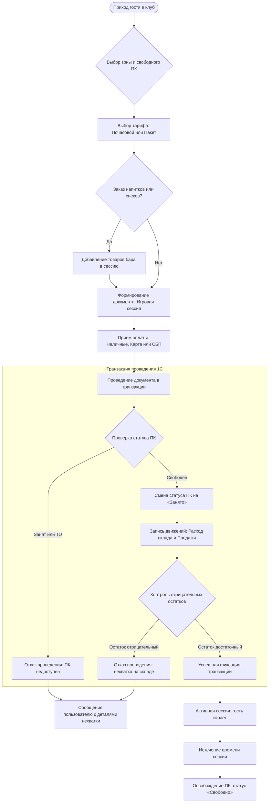
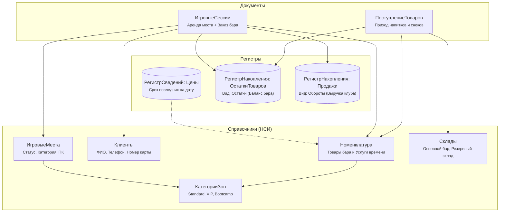

# 🎮 Компьютерный клуб «Астра» — Информационная система управления на платформе 1С:Предприятие 8.3

[](https://v8.1c.ru/)
[]()
[]()
[-blue.svg)]()
[-yellow.svg)]()
[]()
[](LICENSE)

> **Портфолио 1С-разработчика:** Полнофункциональная конфигурация для автоматизации компьютерного (киберспортивного) клуба и сопутствующего розничного бара/снеков.  
> **Автор проекта:** Роман ([@KBAPTETus](https://github.com/KBAPTETus))  
> **Резюме и разбор кейса для тимлидов франчайзи:** [CASE_STUDY.md](CASE_STUDY.md)

---

## 📌 Оглавление
1. [О проекте и бизнес-задачах](#-о-проекте-и-бизнес-задачах)
2. [Моделирование бизнес-процессов (Mermaid BPMN)](#-моделирование-бизнес-процессов)
3. [Архитектура метаданных 1С](#-архитектура-метаданных-1с)
4. [Технический фокус (Deep Dive)](#-технический-фокус-deep-dive)
   - [Новая методика контроля отрицательных остатков](#1-новая-методика-контроля-отрицательных-остатков)
   - [Клиент-серверное разделение контекста в управляемых формах](#2-клиент-серверное-разделение-контекста)
   - [Мониторинг статусов ПК и защита от овербукинга](#3-контроль-статусов-игровых-мест)
   - [Аналитическая отчетность на СКД](#4-аналитическая-отчетность-на-скд)
5. [Структура репозитория](#-структура-репозитория)
6. [Инструкция по быстрому развертыванию](#-инструкция-по-быстрому-развертыванию)
7. [Стандарты разработки 1С](#-соответствие-стандартам-разработки-фирмы-1с)

---

## 💡 О проекте и бизнес-задачах

Конфигурация **«Компьютерный клуб Астра»** создана для комплексной автоматизации киберспортивных клубов и игровых лаундж-пространств. Система решает ключевую отраслевую задачу — объединение **повременных услуг аренды высокопроизводительных ПК** и **розничной торговли бара** в едином прозрачном контуре.

### Решаемые бизнес-задачи:
1. **Предотвращение овербукинга ПК:** контроль текущего статуса компьютеров («Свободно», «Занято», «Недоступно на ТО») на уровне транзакции проведения документа.
2. **Исключение пересортицы и недостач в баре:** списание энергетиков и снеков по *новой методике проведения* с оперативным контролем отрицательных остатков через виртуальные таблицы.
3. **Быстрое обслуживание на ресепшн:** автоматический подбор тарифов, автоподстановка цен из периодического регистра сведений и мгновенный расчет даты завершения сессии прямо на клиенте.
4. **Управленческая прозрачность для владельца:** аналитические отчеты на СКД по загрузке зон клуба (Standard, VIP, Bootcamp) и финансовому вкладу каждого направления бизнеса.

---

### 🔄 Моделирование бизнес-процессов

### Схема процесса «Оформление игровой сессии и обслуживание гостя»



---

## 🏛 Архитектура метаданных 1С



---

## 🛠 Технический фокус (Deep Dive)

### 1. Новая методика контроля отрицательных остатков

При разработке процедуры проведения `ОбработкаПроведения` документа `ИгроваяСессия` применена **современная («новая») методика 1С**.

#### В чем отличие от «старой» методики?
* **Старая методика:** сначала считываются остатки из базы, затем проверяется доступность, и только потом записывается расход. Требует обязательной блокировки данных в управляемом режиме перед чтением. Это удерживает транзакционные блокировки СУБД на протяжении всей обработки и ухудшает масштабируемость при параллельной работе кассиров.
* **Новая методика:** платформа сразу формирует и записывает движения расхода в транзакции (`Движения.ОстаткиТоваров.Записать()`). Затем выполняется единый оптимизированный запрос к виртуальной таблице `ОстаткиТоваров.Остатки` с фильтром по номенклатуре документа и условием `КоличествоОстаток < 0`. Если обнаружен дефицит — транзакция откатывается (`Отказ = Истина`), а пользователю выводится информативное сообщение.

#### Листинг BSL:
```bsl
// Каталог: src/Documents/ИгровыеСессии/Ext/ObjectModule.bsl

Процедура ОбработкаПроведения(Отказ, Режим)
	
	Движения.ОстаткиТоваров.Записывать = Истина;
	Движения.Продажи.Записывать = Истина;
	
	// 1. Проверка доступности игрового места и блокировка от повторной посадки
	Если ЗначениеЗаполнено(ИгровоеМесто) Тогда
		Если ИгровоеМесто.Статус = Перечисления.СтатусПКМеста.Занято Тогда
			Отказ = Истина;
			ВывестиСообщение(СтрШаблон("Игровое место ""%1"" уже занято!", ИгровоеМесто), "ИгровоеМесто");
			Возврат;
		ИначеЕсли ИгровоеМесто.Статус = Перечисления.СтатусПКМеста.Недоступно Тогда
			Отказ = Истина;
			ВывестиСообщение(СтрШаблон("Игровое место ""%1"" находится на ТО!", ИгровоеМесто), "ИгровоеМесто");
			Возврат;
		КонецЕсли;
		
		// Фиксация статуса места
		ОбъектМеста = ИгровоеМесто.ПолучитьОбъект();
		ОбъектМеста.Статус = Перечисления.СтатусПКМеста.Занято;
		ОбъектМеста.Записать();
	КонецЕсли;
	
	// 2. Движения по услугам игрового времени
	Если ЗначениеЗаполнено(Тариф) И СуммаУслуг > 0 Тогда
		ДвПродажи = Движения.Продажи.Добавить();
		ДвПродажи.Период       = Дата;
		ДвПродажи.Номенклатура = Тариф;
		ДвПродажи.Количество   = Длительность; // точное количество часов
		ДвПродажи.Выручка      = СуммаУслуг;
	КонецЕсли;
	
	// 3. Формирование движений по бару (расход склада + выручка)
	Для Каждого СтрБара Из ТоварыБара Цикл
		ДвОстатки = Движения.ОстаткиТоваров.ДобавитьРасход();
		ДвОстатки.Период       = Дата;
		ДвОстатки.Номенклатура = СтрБара.Номенклатура;
		ДвОстатки.Склад        = Склад;
		ДвОстатки.Количество   = СтрБара.Количество;
		
		ДвПродажи = Движения.Продажи.Добавить();
		ДвПродажи.Период       = Дата;
		ДвПродажи.Номенклатура = СтрБара.Номенклатура;
		ДвПродажи.Количество   = СтрБара.Количество;
		ДвПродажи.Выручка      = СтрБара.Сумма;
	КонецЦикла;
	
	// 4. Запись движений перед контролем остатков
	Движения.ОстаткиТоваров.Записать();
	
	// 5. Контроль отрицательных остатков (Новая методика)
	Если ТоварыБара.Количество() > 0 Тогда
		Запрос = Новый Запрос;
		Запрос.Текст = 
			"ВЫБРАТЬ
			|	Остатки.Номенклатура КАК Номенклатура,
			|	Остатки.КоличествоОстаток КАК КоличествоОстаток
			|ИЗ
			|	РегистрНакопления.ОстаткиТоваров.Остатки(
			|			&МоментВремени,
			|			Склад = &Склад
			|				И Номенклатура В
			|					(ВЫБРАТЬ РАЗЛИЧНЫЕ
			|						Док.Номенклатура
			|					ИЗ
			|						Документ.ИгровыеСессии.ТоварыБара КАК Док
			|					ГДЕ
			|						Док.Ссылка = &Ссылка)) КАК Остатки
			|ГДЕ
			|	Остатки.КоличествоОстаток < 0";
		
		Запрос.УстановитьПараметр("МоментВремени", МоментВремени());
		Запрос.УстановитьПараметр("Склад",        Склад);
		Запрос.УстановитьПараметр("Ссылка",       Ссылка);
		
		Выборка = Запрос.Выполнить().Выбрать();
		Пока Выборка.Следующий() Цикл
			Отказ = Истина;
			ВывестиСообщение(СтрШаблон(
				"Недостаточно товара ""%1"" на складе! Не хватает: %2 шт.",
				Выборка.Номенклатура,
				-Выборка.КоличествоОстаток
			));
		КонецЦикла;
	КонецЕсли;
	
КонецПроцедуры
```

---

### 2. Клиент-серверное разделение контекста

В управляемой форме документа `ИгроваяСессия` соблюдены стандарты производительности клиент-серверного взаимодействия:

1. **Исключение лишней сериализации формы:** Функция получения цены номенклатуры из регистра сведений помечена директивой `&НаСервереБезКонтекста`. Это гарантирует, что при выборе товара серверу не передается вся форма с табличными частями, а возвращается лишь одно скалярное значение:
   ```bsl
   &НаСервереБезКонтекста
   Функция ПолучитьАктуальнуюЦенуНаСервере(Номенклатура, ДатаСреза)
       Если Не ЗначениеЗаполнено(Номенклатура) Тогда
           Возврат 0;
       КонецЕсли;
       Отбор = Новый Структура("Номенклатура", Номенклатура);
       ЗначенияЦен = РегистрыСведений.ЦеныНоменклатуры.СрезПоследних(ДатаСреза, Отбор);
       Возврат ?(ЗначенияЦен.Количество() > 0, ЗначенияЦен[0].Цена, 0);
   КонецФункции
   ```
2. **Мгновенный расчет на клиенте:** Все математические операции (вычисление времени окончания `ВремяОкончания = ВремяНачала + Длительность * 3600`, расчет сумм строк `Количество * Цена` и общего итога чека) выполняются на стороне клиента с директивой `&НаКлиенте`, не порождая сетевых round-trip задержек.

---

### 3. Контроль статусов игровых мест

* При проведении документ резервирует ПК (`Статус = Занято`).
* В процедуре `ОбработкаУдаленияПроведения` реализовано автоматическое освобождение игрового места (`Статус = Свободно`), что предотвращает зависание оборудования в заблокированном состоянии при отмене сессии:
  ```bsl
  Процедура ОбработкаУдаленияПроведения(Отказ)
      Если ЗначениеЗаполнено(ИгровоеМесто) Тогда
          ОбъектМеста = ИгровоеМесто.ПолучитьОбъект();
          ОбъектМеста.Статус = Перечисления.СтатусПКМеста.Свободно;
          ОбъектМеста.Записать();
      КонецЕсли;
  КонецПроцедуры
  ```

---

### 4. Аналитическая отчетность на СКД

В конфигурации разработаны схемы компоновки данных (СКД), использующие агрегатные виртуальные таблицы регистров накопления:

1. **`ОтчетПоОстаткамБара`** (`Report.ОтчетПоОстаткамБара`):
   * Источник данных: виртуальная таблица `ОстаткиТоваров.Остатки(&Период, )`.
   * Иерархия: группировка `Склад` -> `Номенклатура`.
   * Ресурс: `Сумма(КоличествоОстаток)`.
   * Позволяет администратору мгновенно оценить фактические остатки и сформировать заявку на закупку.
2. **`ВыручкаИЗагрузкаКлуба`** (`Report.ВыручкаИЗагрузкаКлуба`):
   * Источник данных: виртуальная таблица `Продажи.Обороты(&НачалоПериода, &КонецПериода, Авто, )`.
   * Группировка: `ВидНоменклатуры` (Услуги ПК vs Бар) -> `Номенклатура`.
   * Ресурсы: `Сумма(КоличествоОборот)`, `Сумма(ВыручкаОборот)`.
   * Обеспечивает руководству клуба прозрачную аналитику маржинальности направлений за любой период.

---

## 📂 Структура репозитория

```text
├── src/                                  # Официальная выгрузка конфигурации 1С в XML/BSL
│   ├── AccumulationRegisters/            # Регистры накопления: ОстаткиТоваров, Продажи
│   ├── Catalogs/                         # Справочники: ИгровыеМеста, Номенклатура, Клиенты, Склад...
│   ├── CommonModules/                    # Общие модули: КлубСервер, КлубКлиентСервер
│   ├── Documents/                        # Документы: ИгровыеСессии, ПоступлениеТоваров
│   ├── Enums/                            # Перечисления: ВидыНоменклатуры, СпособыОплаты, СтатусПКМеста
│   ├── InformationRegisters/             # Регистры сведений: ЦеныНоменклатуры
│   ├── Reports/                          # Отчеты СКД: ОтчетПоОстаткамБара, ВыручкаИЗагрузкаКлуба
│   ├── Subsystems/                       # Подсистемы: Обслуживание, СкладИЗакупки, Аналитика...
│   ├── Configuration.xml                 # Корневой манифест конфигурации
│   └── ConfigDumpInfo.xml                # Хэши и версии выгрузки метаданных
├── bsl/                                  # Чистые модули BSL для быстрого просмотра в GitHub
│   ├── Документы/
│   │   ├── ИгроваяСессия/                # МодульОбъекта.bsl и МодульФормы.bsl
│   │   └── ПоступлениеТоваров/           # МодульОбъекта.bsl и МодульФормы.bsl
│   ├── ОбщиеМодули/                      # КлубСервер.bsl и КлубКлиентСервер.bsl
│   └── Отчеты/                           # Тексты запросов схем компоновки данных (СКД)
├── build/                                # Скомпилированные файлы для развертывания
│   ├── КомпьютерныйКлубАстра.cf          # Дистрибутивный файл поставки конфигурации
│   └── КомпьютерныйКлубАстра_ДемоБаза.dt # Выгрузка демонстрационной базы с данными
├── docs/                                 # Аналитическая документация
│   └── Бизнес_Анализ_и_Архитектура.md    # Предпроектный анализ предметной области
├── .gitignore                            # Фильтрация временных файлов и логов 1С
├── .gitattributes                        # Нормализация окончаний строк CRLF для BSL
├── CASE_STUDY.md                         # Разбор кейса и ответы на вопросы собеседования
└── README.md                             # Документация проекта
```

---

## 🚀 Инструкция по быстрому развертыванию

### Способ 1: Быстрый запуск из файла конфигурации (.cf) или демо-базы (.dt)

1. Запустите **1С:Предприятие 8.3** (учебную или коммерческую версию платформы).
2. Нажмите **Добавить** -> **Создание новой информационной базы** -> **Создание информационной базы без конфигурации**.
3. Укажите имя базы, например `Компьютерный клуб Астра`, и выберите каталог на диске.
4. Откройте базу в режиме **Конфигуратор**.
5. **Загрузка конфигурации:**
   * Меню **Конфигурация** -> **Загрузить конфигурацию из файла...** -> выберите [build/КомпьютерныйКлубАстра.cf](build/КомпьютерныйКлубАстра.cf).
   * Либо (для базы с готовыми тестовыми данными): меню **Администрирование** -> **Загрузить информационную базу...** -> выберите [build/КомпьютерныйКлубАстра_ДемоБаза.dt](build/КомпьютерныйКлубАстра_ДемоБаза.dt).
6. Нажмите клавишу **F5** (или меню *Отладка* -> *Начать отладку*) для запуска в режиме «1С:Предприятие»!

---

### Способ 2: Сборка из модульных исходников `src/` через командную строку (CLI)

```bash
# 1. Клонирование репозитория
git clone https://github.com/KBAPTETus/Astra-Club-1C.git
cd Astra-Club-1C

# 2. Создание пустой информационной базы (Linux / Windows)
1cv8 CREATEINFOBASE File="$(pwd)/ib_astra"

# 3. Загрузка конфигурации из модульных исходников src/ и обновление структуры БД
1cv8 DESIGNER /F "$(pwd)/ib_astra" /LoadConfigFromFiles "$(pwd)/src" /UpdateDBCfg

# 4. Запуск в режиме предприятия с интерфейсом «Такси»
1cv8 ENTERPRISE /F "$(pwd)/ib_astra"
```

---

## ✅ Соответствие стандартам разработки фирмы «1С»

* [x] **Именование объектов и переменных:** соблюден PascalCase, осмысленные русскоязычные идентификаторы.
* [x] **Клиент-серверное разделение:** минимизация контекстных серверных вызовов, применение `&НаСервереБезКонтекста`.
* [x] **Блокировки и транзакции:** управляемый режим блокировок (`Managed`), современная методика контроля отрицательных остатков.
* [x] **Отказ от синхронных модальных окон:** использование асинхронных паттернов и стандартных оповещений платформы (`СообщениеПользователю`).
* [x] **Версионирование под Git:** чистая структура исходных текстов, правильный `.gitignore` и `.gitattributes`.

---

## 👨‍💻 Об авторе проекта

* **Разработчик:** Роман ([KBAPTETus](https://github.com/KBAPTETus))
* **Email:** svatknyasev25@gmail.com
* **GitHub:** [https://github.com/KBAPTETus](https://github.com/KBAPTETus)
* **Готовность к работе:** Рассматриваю предложения на позицию Junior 1C Developer / Стажер-разработчик 1С в франчайзи и инхаус-командах.
