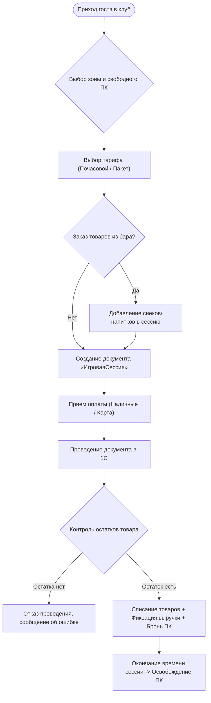
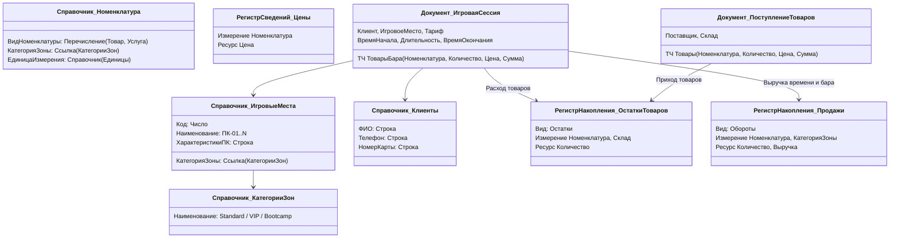

# Предпроектный анализ и архитектура: Компьютерный клуб «Астра»

## 1. Паспорт проекта
* **Наименование проекта:** Информационная система управления компьютерным клубом «Астра»
* **Конфигурация:** `КомпьютерныйКлубАстра`
* **Платформа:** 1С:Предприятие 8.3 (управляемое приложение, интерфейс «Такси»)
* **Целевая аудитория портфолио:** Тимлиды 1С, ведущие аналитики, HR-специалисты в франчайзи и инхаус
* **Ключевой фокус:** Комплексный Junior (архитектура НСИ + сфера услуг и розницы + проведение с контролем остатков + BSL + отчеты СКД)

---

## 2. Анализ предметной области и бизнес-требований

### 2.1. Специфика бизнеса компьютерного клуба
Компьютерный клуб сочетает в себе два ключевых направления деятельности:
1. **Услуги игрового времени:**
   * Дифференциация игровых мест (Общий зал / Standard, VIP-комнаты, зона консолей PS5 / Bootcamp).
   * Гибкая тарификация (почасовая аренда, фиксированные пакеты «Утро», «Вечер», «Ночь»).
   * Учет статусов ПК (Свободен, Занят, На техобслуживании).
2. **Товарный контур (Бар и снеки):**
   * Закупка напитков (энергетики, газировки), снеков (чипсы, сэндвичи) и сопутствующих товаров.
   * Продажа товаров гостям во время игровых сессий или на стойке ресепшн.
   * Строгий складской учет остатков с запретом отрицательных остатков.

### 2.2. Роли пользователей (Стейкхолдеры)
* **Администратор клуба:** открывает и закрывает игровые сессии, продает напитки/снеки, принимает оплату (наличные/карта), проводит инвентаризацию бара.
* **Управляющий / Владелец клуба:** анализирует выручку, загрузку зон и отдельных ПК, маржинальность бара, контролирует остатки на складе.

---

## 3. Моделирование ключевых бизнес-процессов (BPMN / Flowchart)

### 3.1. Процесс «Игровая сессия и обслуживание гостя»

---

## 4. Архитектура метаданных 1С

---

## 5. Детальная спецификация объектов конфигурации

### 5.1. Подсистемы
1. **`Обслуживание`** (Рабочее место администратора: Игровые сессии, статус ПК, продажа бара).
2. **`СкладИЗакупки`** (Поступление товаров, номенклатура, остатки).
3. **`АналитикаИОтчеты`** (Финансовые и операционные отчеты для руководства).
4. **`Настройки`** (Тарифы, цены, зоны, оборудование).

### 5.2. Нормативно-справочная информация (НСИ)
* **Перечисления:**
  * `ВидыНоменклатуры`: `Товар`, `Услуга`.
  * `СпособыОплаты`: `Наличные`, `БанковскаяКарта`, `СБП`.
  * `СтатусыМест`: `Свободен`, `Занят`, `ТехОбслуживание`.
* **Справочники:**
  * `КатегорииЗон` (Стандарт, VIP, Lounge / PS5).
  * `ИгровыеМеста` (Реквизиты: `КатегорияЗоны`, `КонфигурацияПК`, `Статус`).
  * `Клиенты` (Реквизиты: `Телефон`, `НомерКарты`, `Комментарий`).
  * `Склады` (Основной бар, Резервный склад).
  * `Номенклатура` (Реквизиты: `ВидНоменклатуры`, `КатегорияЗоны`).

### 5.3. Регистры сведений
* **`ЦеныНоменклатуры`** (Периодический: В пределах дня):
  * *Измерения:* `Номенклатура` (СправочникСсылка.Номенклатура).
  * *Ресурсы:* `Цена` (Число 15,2).

### 5.4. Документы и движения
* **`ПоступлениеТоваров`:**
  * *Шапка:* `Поставщик`, `Склад`.
  * *ТЧ «Товары»:* `Номенклатура`, `Количество`, `Цена`, `Сумма`.
  * *Движения:*
    * `ОстаткиТоваров` (+ Приход).

* **`ИгроваяСессия`:**
  * *Шапка:* `Клиент`, `ИгровоеМесто`, `Тариф` (Услуга), `ВремяНачала`, `ДлительностьЧасов`, `ВремяОкончания`, `СуммаУслуг`, `СуммаБара`, `ВсегоСумма`, `СпособОплаты`.
  * *ТЧ «ТоварыБара»:* `Номенклатура`, `Количество`, `Цена`, `Сумма`.
  * *Движения:*
    * `ОстаткиТоваров` (- Расход товаров бара с блокировкой и контролем отрицательных остатков).
    * `Продажи` (+ Обороты по услугам времени и проданным товарам).

---

## 6. Логика проведения и контроль остатков (Методика 1С)

В процедуре `ОбработкаПроведения` документа `ИгроваяСессия` реализуется **современная методика контроля остатков**:
1. Формирование движений по списанию товаров.
2. Запись движений в транзакции.
3. Проверка остатков запросом к виртуальной таблице `ОстаткиТоваров.Остатки` с фильтром по текущему документу.
4. Если `КоличествоОстаток < 0`, выставляется `Отказ = Истина`, пользователю выводится информативное сообщение (какого именно энергетика/снека не хватило и сколько не хватает), и транзакция откатывается.

---

## 7. Отчеты на СКД (Система компоновки данных)

1. **`ОтчетПоОстаткамБара`:**
   * Виртуальная таблица: `ОстаткиТоваров.Остатки`.
   * Группировка: `Склад` -> `Номенклатура`.
   * Поля: `КоличествоОстаток`.
2. **`ВыручкаИЗагрузкаКлуба`:**
   * Виртуальная таблица: `Продажи.Обороты`.
   * Группировки: по периоду (день/месяц), по видам (Услуги ПК vs Бар), по категориям зон (Standard vs VIP).
   * Вычисляемые поля: доля выручки бара в чеке.

---

## 8. Пошаговый план разработки (Roadmap реализации)

* **Шаг 1:** Создание подсистем и нормативно-справочной информации (Перечисления, Справочники).
* **Шаг 2:** Создание регистра сведений `ЦеныНоменклатуры` и документа `ПоступлениеТоваров` с проведением.
* **Шаг 3:** Разработка документа `ИгроваяСессия` с управляемой формой (авторасчет времени окончания и автоподстановка цен).
* **Шаг 4:** Программирование проведения с контролем отрицательных остатков на BSL.
* **Шаг 5:** Создание аналитических отчетов на СКД.
* **Шаг 6:** Оформление документации и скриншотов в портфолио.
